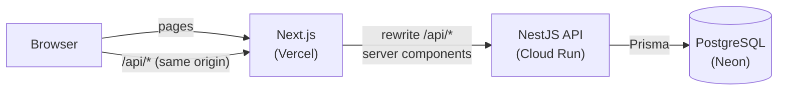

# Riflessi d'Auto

[](https://github.com/AndreaTkachuk/riflessi-auto/actions/workflows/ci.yml)


A car portal for the Italian market. It has a catalog of **new cars** (brand → model → version, with specs
and list prices) and **side-by-side comparison** of up to three versions. **Used-car listings** and an
**AI assistant** that suggests cars from the catalog will come later.

The site's UI is in Italian. The code, commits and docs are in English.

> **Status:** work in progress. The data model, roles and permissions are
> designed so the site can be monetized later (featured listings, dealer subscriptions).

---

## Features

### Done

- **Catalog API**: brands, models and versions. Public routes are addressed by slug (SEO-friendly); admin
  CRUD routes live under `/api/admin/*`.
- **Version specs**: years, fuel type (incl. mild/full/plug-in hybrid and electric), transmission, engine,
  power (kW/CV), WLTP consumption and CO₂, battery and electric range, Euro class, doors and seats, and the
  list price.
- **"Novità"**: recently launched models with a badge (New model, New generation, Facelift) for the home page.
- **Auth**: register, login, logout and current user. JWT in an httpOnly cookie, argon2 password hashing,
  roles `ADMIN | EDITOR | DEALER | USER`.
- **Admin panel** (`/admin`): manage brands, models and versions, with filters and inline forms.
- **Seed**: the 87 brands sold on the Italian market.
- **Aura design system**: gradients, glow effects, light/dark themes, and it respects `prefers-reduced-motion`.
- **Tests and CI/CD**: unit and end-to-end tests against a real PostgreSQL, run on every PR. A merge to
  `main` deploys automatically.

### Roadmap

- [ ] Catalog data seed (popular models and versions)
- [ ] Photos and brand logos (Cloudflare R2, presigned uploads)
- [ ] Home page with real novità + `/confronta` (compare up to 3 versions, highlight the best values)
- [ ] Public catalog pages: `/catalogo/[brand]/[model]`
- [ ] AI assistant that suggests versions from the catalog
- [ ] Used-car listings, favorites, dealer profiles
- [ ] Monetization: featured listings, dealer subscriptions

---

## Tech stack

| Area      | Technology                                                                            |
| --------- | ------------------------------------------------------------------------------------- |
| Frontend  | Next.js 16 (App Router, Turbopack), React 19, Tailwind CSS 4, `next-themes`           |
| Backend   | NestJS 12 (ES modules), `class-validator`, JWT (`@nestjs/jwt`), argon2                |
| Database  | PostgreSQL 17, Prisma 7 (`@prisma/adapter-pg`)                                        |
| Shared    | `@riflessi/shared`: the API contract (enums, response types, `slugify`) for both apps |
| Tooling   | pnpm workspaces, TypeScript, Vitest, Supertest, oxlint, ESLint                        |
| Infra     | Vercel (web), Google Cloud Run (API), Neon (Postgres), GitHub Actions                 |
| Local dev | VS Code Dev Container + Podman                                                        |

---

## Architecture



- The browser only ever talks to the Next.js origin, and `/api/*` is rewritten to the NestJS API.
  Because of that, the auth cookie works **without CORS**.
- Server components call the API directly. They forward the cookie only on routes that need a login, and
  they skip the request entirely when there is no session.
- **Closed by default**: a global NestJS guard requires a login on every route. Open routes are marked with
  `@Public()`, and role checks use `@Roles(...)`. Roles are read from the database, not from the token.
- `@riflessi/shared` holds the API contract. A compile-time check fails the build if the shared enums
  drift from the Prisma schema.

---

## Repository structure

```
riflessi-auto/
├── apps/
│   ├── api/          # @riflessi/api: NestJS + Prisma (schema, migrations, seed, e2e tests)
│   └── web/          # @riflessi/web: Next.js (public site + admin panel)
├── packages/
│   └── shared/       # @riflessi/shared: API contract shared by api and web
├── .devcontainer/    # Node 24 dev container; starts PostgreSQL with Podman on the host
└── .github/workflows # CI (lint, typecheck, tests, build) and API deploy
```

---

## Getting started

### Requirements

- VS Code with the **Dev Containers** extension, plus Podman or Docker on the host.
- Or, without a container: Node 24, pnpm 12 (via `corepack enable`) and PostgreSQL 17.

### Run locally

1. Open the repo in VS Code and run **Dev Containers: Reopen in Container**. A PostgreSQL container is
   started on the host, and `DATABASE_URL` is set inside the dev container.
2. Create `apps/api/.env`:
   ```env
   JWT_SECRET=any-long-random-string
   ```
3. Create `apps/web/.env.local`:
   ```env
   API_URL=http://localhost:3001
   ```
4. Install dependencies, apply the migrations and seed the database:
   ```bash
   pnpm install
   pnpm build:shared   # the API and the seed import @riflessi/shared from dist/
   cd apps/api
   pnpm prisma migrate dev
   pnpm prisma db seed
   cd ../..
   ```
5. Start both apps:
   ```bash
   pnpm dev        # web → http://localhost:3000, api → http://localhost:3001/api
   ```

To use the admin panel, register a user and give it the `ADMIN` role:

```bash
cd apps/api
echo "UPDATE \"User\" SET role = 'ADMIN' WHERE email = 'you@example.com';" | pnpm prisma db execute --stdin
```

---

## Testing

| Command (in `apps/api`) | What it does                                                                                         |
| ----------------------- | ---------------------------------------------------------------------------------------------------- |
| `pnpm test`             | Unit tests (Vitest), e.g. the auth guard                                                             |
| `pnpm test:e2e`         | API end-to-end tests against a separate `riflessi_test` database, created and migrated automatically |
| `pnpm lint`             | oxlint; warnings fail the build                                                                      |
| `pnpm typecheck`        | `tsc --noEmit`, including tests                                                                      |

The shared package has its own unit tests (`pnpm --filter @riflessi/shared test`). In `apps/web`, use
`pnpm lint` and `pnpm build` (the build includes type checking).

---

## CI/CD

- **CI** runs on every pull request and on every push to `main`, as three parallel jobs: `api` (build,
  lint, typecheck, unit tests), `e2e` (PostgreSQL service container), and `web` (lint, build).
- `main` is protected: changes go through a pull request from `dev`, with green checks.
- **API deploy** runs after CI is green on `main`, and only when the API or shared code changed. It applies
  `prisma migrate deploy` to Neon, builds the Docker image, and deploys to Cloud Run. GitHub authenticates
  to Google Cloud with Workload Identity Federation (no JSON keys), and runtime secrets come from Secret Manager.
- The **web** app is deployed by Vercel.
